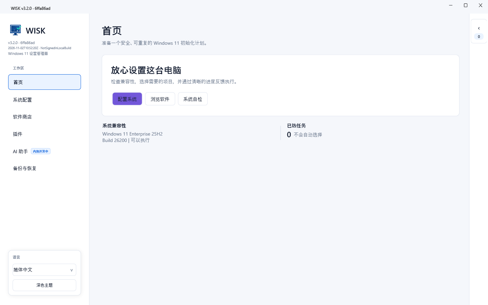
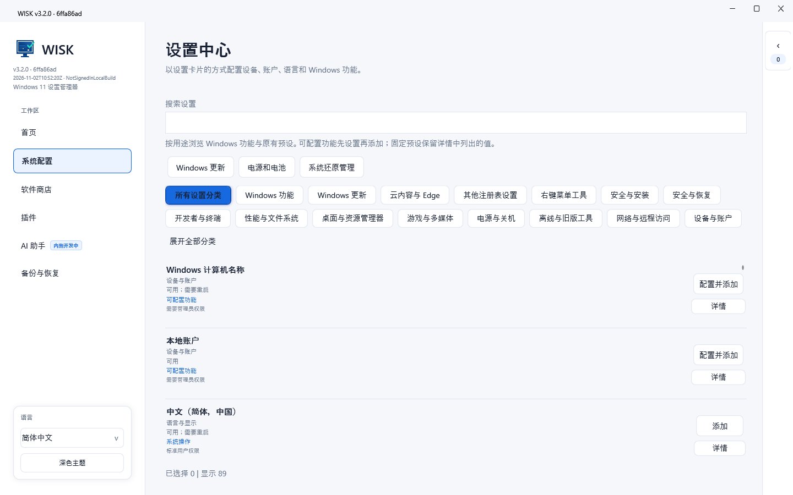
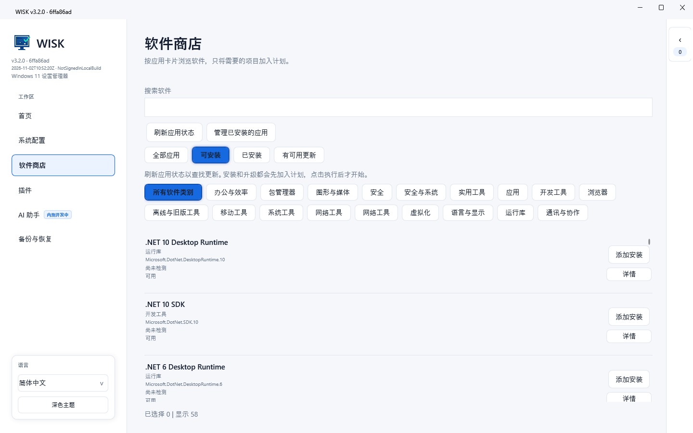
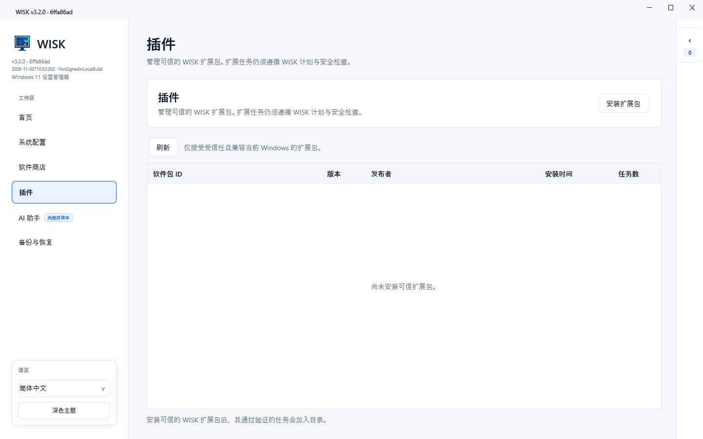
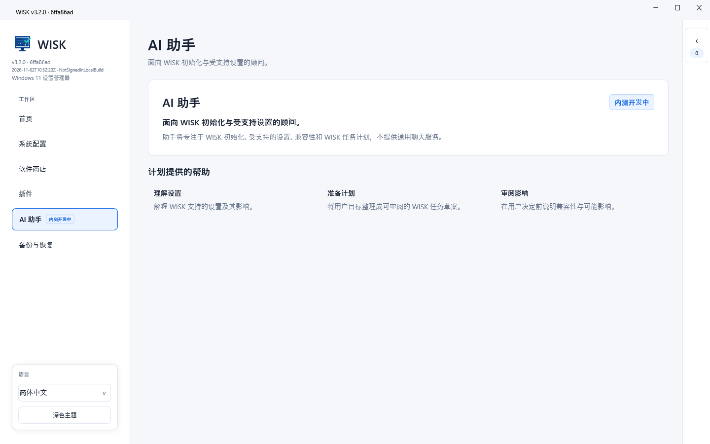

# WISK 3.2

[English](README.md) | [简体中文](docs/README.zh-CN.md) | [Русский](docs/README.ru-RU.md)

[](https://github.com/MeowLove/WISK/actions/workflows/ci.yml)
[](LICENSE)
[](https://github.com/MeowLove/WISK/releases)
[](https://github.com/MeowLove/WISK/stargazers)

WISK (Windows Init Setup Kit) is an open-source Windows 11 initialization and configuration workspace. It combines auditable system settings, registry-backed features, software actions, recovery evidence, and a safe Check -> Apply -> Verify execution model.

WISK is the Windows member of the MeowLove Init Setup Kit family. The Linux counterpart is [LISK](https://github.com/MeowLove/LISK).

<p></p>

## About

WISK is designed for people who want a repeatable, reviewable Windows setup workflow instead of a collection of opaque one-click tweaks.

- Current source version: **WISK 3.2.0**
- Last public release: [WISK 3.0.0](https://github.com/MeowLove/WISK/releases/tag/v3.0.0)
- Project releases: [GitHub Releases](https://github.com/MeowLove/WISK/releases)
- Issue reporting: [GitHub Issues](https://github.com/MeowLove/WISK/issues/new?template=bug_report.md)
- Architecture: [WISK architecture](docs/WISK-3.0-Architecture.md)
- Testing guide: [Release testing guide](docs/Preview-Testing.md)

The 3.2 source line continues the controlled plugin workspace and the AI assistant placeholder labeled “In beta development.” It does not call a cloud AI API, run a local AI model, or execute AI-generated actions.

## Screenshots

<!-- WISK_SCREENSHOT_1_START: Main workspace and navigation -->

<!-- WISK_SCREENSHOT_1_END -->

<!-- WISK_SCREENSHOT_2_START: Settings catalog and category filter -->

<!-- WISK_SCREENSHOT_2_END -->

<!-- WISK_SCREENSHOT_3_START: Software catalog and selected filters -->

<!-- WISK_SCREENSHOT_3_END -->

<!-- WISK_SCREENSHOT_4_START: Controlled plugin workspace -->

<!-- WISK_SCREENSHOT_4_END -->

<!-- WISK_SCREENSHOT_5_START: AI assistant status -->

<!-- WISK_SCREENSHOT_5_END -->

## What It Does

- Organizes Windows initialization tasks into a public, inspectable catalog.
- Builds a reviewed plan before applying system, registry, or software changes.
- Uses explicit **Check -> Apply -> Verify** boundaries for supported tasks.
- Preserves task relationships, risk levels, plan hashes, and execution evidence.
- Backs up original values before supported registry writes.
- Separates restart-required results from later verification results.
- Supports a controlled plugin workspace without allowing extensions to bypass authorization or audit records.
- Reuses the same contracts in the WPF application and the CLI.

WISK is an administrative tool. It is not a generic system optimizer, a cloud AI agent, or an unattended script runner.

## Use Cases

WISK is intended for these workflows:

- Review a new Windows 11 installation before making changes.
- Prepare a repeatable workstation setup plan.
- Group software, language, privacy, desktop, Explorer, and power tasks by purpose.
- Inspect dependencies, conflicts, permissions, and reboot requirements before execution.
- Keep an auditable record of what was planned, applied, and verified.
- Export recovery evidence and diagnostic information for manual review.

## Requirements

- Windows 11 x64
- .NET 10 Windows Desktop Runtime for framework-dependent builds
- Administrator permission only when a selected task requires it
- .NET SDK `10.0.401` for local development

The runtime and operating-system baseline alone do not guarantee that every task is available. WISK reports task availability and compatibility evidence before execution where it can do so reliably.

## Quick Start

1. Download the last public release, WISK 3.0.0, or build the WISK 3.2 source locally.
2. Start the application and inspect the catalog.
3. Configure parameterized tasks before adding them to the plan.
4. Review dependencies, conflicts, risk levels, and required permissions.
5. Run **Check** and review the resulting plan.
6. Confirm the plan and required authorizations before **Apply**.
7. Review **Verify** results after execution; complete a restart first when the task requires it.

The current source line is not presented as a completed system-level acceptance release. Default local builds are unsigned, and real UAC, registry Apply/Verify, software installation, reboot, and Authenticode validation require an isolated Windows test environment.

## Typical Workflows

### Prepare a workstation plan

1. Open the catalog with ordinary user permission.
2. Configure parameterized tasks and review dependencies, conflicts, risk, and reboot requirements.
3. Run **Check** and inspect the immutable plan before deciding whether to apply it.

### Review a system change

1. Select one narrowly scoped task instead of a broad batch.
2. Confirm the task's availability and authorization requirements.
3. Apply only in a disposable, isolated Windows environment with a tested recovery path.
4. Review **Verify** after the operation and again after any required restart.

### Prepare feedback

1. Record the WISK version, Windows edition/build, runtime mode, task ID, and exact steps.
2. Export diagnostics when available and inspect them for personal paths, device names, and other sensitive values.
3. Attach only sanitized evidence to a GitHub issue.

## Build and Test

The repository uses the SDK pinned in `global.json` and keeps generated output under `artifacts/`.

```powershell
.\Build-Wisk.ps1 -Target Build -Profile Development -RuntimeMode FrameworkDependent -Restore
.\Build-Wisk.ps1 -Target Test -Profile Test -RuntimeMode FrameworkDependent -Restore -Coverage
.\Build-Wisk.ps1 -Target Publish -Profile Release -RuntimeMode FrameworkDependent
.\Build-Wisk.ps1 -Target Publish -Profile Release -RuntimeMode SelfContained
node tools/validate-catalog.mjs
```

For release packaging, use `packaging/Publish-Release.ps1` or `packaging/Publish-Cli.ps1`. They create Windows x64 single-file packages and write manifests containing the source commit, payload hash, build time, and signature status.

## Architecture and Tech Stack

- **WPF application**: Home, Settings, Software, Plugins, AI assistant, and Backup & recovery workspaces.
- **CLI**: Reuses the same contracts and execution boundaries; read-only by default.
- **Contracts and Core**: Own task descriptors, plans, templates, relations, validation, and catalog data.
- **Execution**: Owns Check -> Apply -> Verify state, history, diagnostics, cancellation, and restart boundaries.
- **Windows platform layer**: Maps allow-listed task IDs to registry, WinGet, Windows capability, and native settings adapters.
- **PowerShell bridge**: Uses fixed operations and framed JSON instead of concatenating user input into scripts.

See the [architecture document](docs/WISK-3.0-Architecture.md) for repository boundaries and runtime layers.

## Troubleshooting and Feedback

- If a task is unavailable, review its Check result, requirements, dependencies, and compatibility evidence before changing the plan.
- If a result requires a restart, treat Apply completion and post-restart Verify as separate facts.
- If Verify cannot read a reliable state, use the manual-review status instead of treating it as success.
- Use the [release testing guide](docs/Preview-Testing.md) for package verification and isolated-test boundaries.
- Report reproducible problems through [GitHub Issues](https://github.com/MeowLove/WISK/issues/new?template=bug_report.md).

Diagnostic exports use best-effort redaction. Review screenshots, logs, paths, device identifiers, and software lists before sharing them.

## Safety Boundary

- Catalog entries are unselected by default.
- Elevated and high-risk tasks require explicit authorization.
- Check must remain read-only for system-changing operations.
- Original registry values are captured before supported writes.
- Real Apply/Verify validation belongs in an isolated Windows test environment.
- Do not apply changes on a daily-use, work, or production computer without a tested recovery path.

## Repository Layout

```text
src/                 WISK application layers and shared contracts
tests/               Core, execution, bridge, catalog, and UI contract tests
catalog/             Public software/settings catalog metadata
schema/              Machine-readable catalog and profile schemas
packaging/           Release and CLI publishing wrappers
tools/               Validation and smoke utilities
docs/                Public architecture and development documentation
artifacts/           Ignored build, test, and publish output
```

## Contributing

See [`CONTRIBUTING.md`](CONTRIBUTING.md), [`AGENTS.md`](AGENTS.md), and the [documentation index](docs/README.md). Do not submit local requirements, credentials, user data, signing keys, or generated build output.

## License

See [LICENSE](LICENSE).
