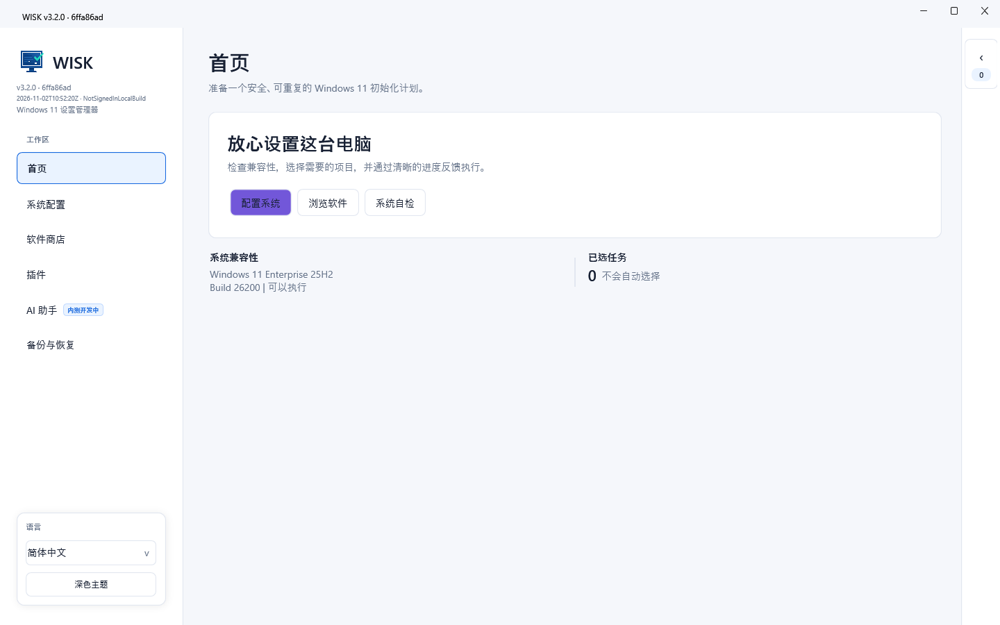
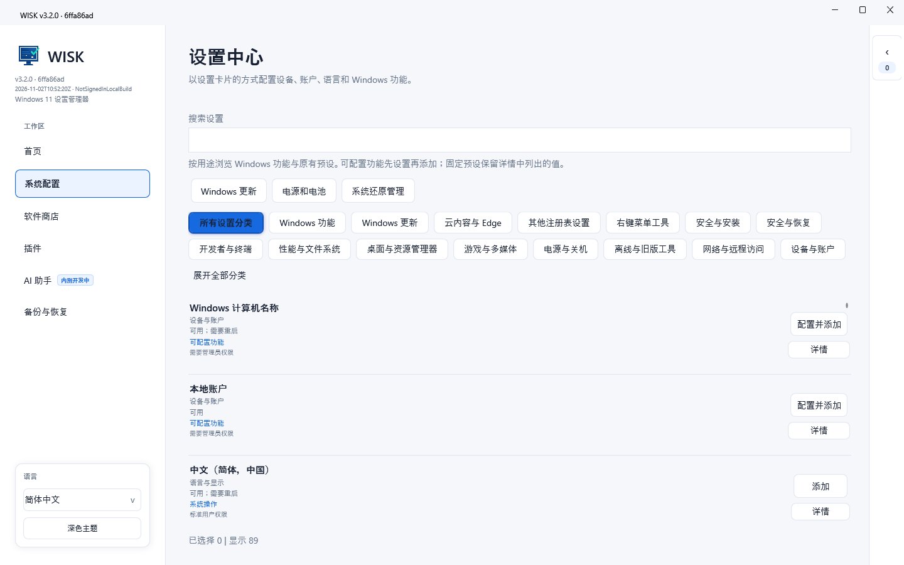
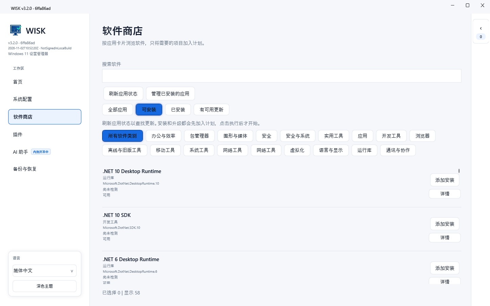
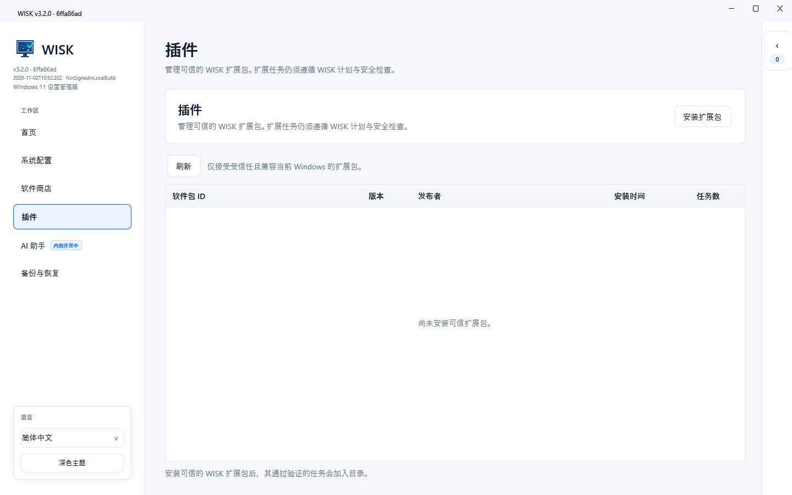
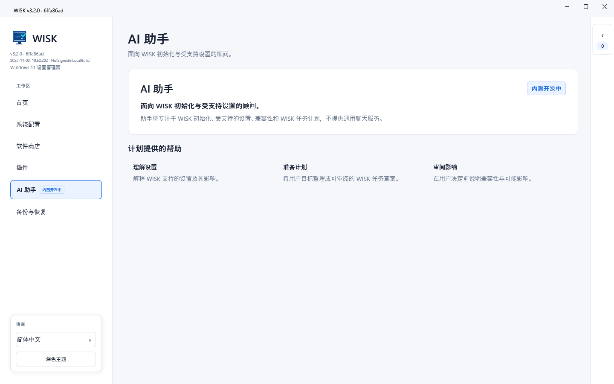

# WISK 3.2

[English](../README.md) | [简体中文](README.zh-CN.md) | [Русский](README.ru-RU.md)

[](https://github.com/MeowLove/WISK/actions/workflows/ci.yml)
[](../LICENSE)
[](https://github.com/MeowLove/WISK/releases)
[](https://github.com/MeowLove/WISK/stargazers)

WISK (Windows Init Setup Kit) — это открытая рабочая среда для первоначальной настройки и конфигурации Windows 11. Она объединяет проверяемые системные параметры, функции на основе реестра, операции с программами, доказательства восстановления и безопасную модель Check -> Apply -> Verify.

WISK — Windows-проект семейства MeowLove Init Setup Kit. Проект для Linux называется [LISK](https://github.com/MeowLove/LISK).

## О проекте

WISK предназначен для повторяемого и проверяемого процесса настройки Windows, а не для набора непрозрачных автоматических твиков.

- Текущая версия исходного кода: **WISK 3.2.0**
- Последний публичный релиз: [WISK 3.0.0](https://github.com/MeowLove/WISK/releases/tag/v3.0.0)
- Релизы проекта: [GitHub Releases](https://github.com/MeowLove/WISK/releases)
- Сообщения об ошибках: [GitHub Issues](https://github.com/MeowLove/WISK/issues/new?template=bug_report.md)
- Архитектура: [документ архитектуры WISK](WISK-3.0-Architecture.md)
- Руководство по тестированию: [руководство по тестированию релиза](Preview-Testing.md)

В исходной ветке 3.2 сохраняются управляемая рабочая область расширений и заглушка AI-помощника со статусом «Внутренняя разработка». Текущая версия не обращается к облачному AI API, не запускает локальную AI-модель и не выполняет действия, созданные AI.

## Скриншоты

<!-- WISK_SCREENSHOT_1_START: Основная рабочая область и навигация -->

<!-- WISK_SCREENSHOT_1_END -->

<!-- WISK_SCREENSHOT_2_START: Каталог настроек и фильтр категорий -->

<!-- WISK_SCREENSHOT_2_END -->

<!-- WISK_SCREENSHOT_3_START: Каталог программ и фильтры -->

<!-- WISK_SCREENSHOT_3_END -->

<!-- WISK_SCREENSHOT_4_START: Управляемая рабочая область расширений -->

<!-- WISK_SCREENSHOT_4_END -->

<!-- WISK_SCREENSHOT_5_START: Статус AI-помощника -->

<!-- WISK_SCREENSHOT_5_END -->

## Возможности

- Организация задач настройки Windows в открытом проверяемом каталоге.
- Создание проверяемого плана перед изменениями системы, реестра или программ.
- Явные границы **Check -> Apply -> Verify** для поддерживаемых задач.
- Сохранение связей задач, уровней риска, хэшей планов и результатов выполнения.
- Резервное сохранение исходных значений перед поддерживаемой записью в реестр.
- Отдельный учёт необходимости перезагрузки и последующей проверки.
- Управляемая рабочая область расширений без обхода авторизации и аудита.
- Общие контракты для WPF-приложения и CLI.

WISK — административный инструмент. Это не универсальный оптимизатор системы, не облачный AI-агент и не средство запуска сценариев без контроля пользователя.

## Сценарии использования

- Проверка новой установки Windows 11 перед изменениями.
- Подготовка повторяемого плана настройки рабочей станции.
- Группировка задач программ, языков, конфиденциальности, рабочего стола, Проводника и питания.
- Проверка зависимостей, конфликтов, прав и требований перезагрузки до выполнения.
- Сохранение аудируемой записи планов, операций и проверок.
- Экспорт доказательств восстановления и диагностических данных для ручной проверки.

## Требования

- Windows 11 x64
- .NET 10 Windows Desktop Runtime для framework-dependent сборок
- Права администратора только для выбранных задач, которым они необходимы
- .NET SDK `10.0.401` для локальной разработки

Даже при выполнении базовых требований отдельные задачи могут быть недоступны. Если это можно надёжно определить, WISK показывает доступность и данные о совместимости до выполнения.

## Быстрый старт

1. Скачайте последний публичный релиз WISK 3.0.0 или соберите локально исходный код WISK 3.2.
2. Запустите приложение и просмотрите каталог.
3. Настройте параметры до добавления параметризованных задач в план.
4. Проверьте зависимости, конфликты, уровень риска и необходимые права.
5. Выполните **Check** и изучите результат плана.
6. Подтвердите план и необходимые разрешения перед **Apply**.
7. После выполнения изучите результат **Verify**; если требуется перезагрузка, сначала выполните её.

Текущая исходная ветка не заявляется как полностью принятый системный релиз. Локальные сборки по умолчанию не подписаны, а реальные UAC, Apply/Verify для реестра, установка программ, перезагрузка и Authenticode требуют изолированной среды Windows.

## Типовые рабочие процессы

### Подготовка плана рабочей станции

1. Откройте каталог с обычными правами пользователя.
2. Настройте параметризованные задачи и проверьте зависимости, конфликты, риск и требования перезагрузки.
3. Выполните **Check** и изучите неизменяемый план до решения о применении.

### Проверка системного изменения

1. Начните с одной задачи с узкой областью действия, а не с большого пакета.
2. Подтвердите доступность задачи и требования авторизации.
3. Выполняйте Apply только в одноразовой изолированной среде Windows с проверенным восстановлением.
4. Изучите **Verify** после операции и ещё раз после необходимой перезагрузки.

### Подготовка сообщения об ошибке

1. Укажите версию WISK, выпуск/сборку Windows, режим выполнения, ID задачи и точные шаги.
2. При наличии диагностики проверьте её на личные пути, имена устройств и другие чувствительные данные.
3. Прикладывайте к GitHub Issue только обезличенные материалы.

## Сборка и тестирование

Репозиторий использует SDK из `global.json` и помещает сгенерированные файлы в `artifacts/`.

```powershell
.\Build-Wisk.ps1 -Target Build -Profile Development -RuntimeMode FrameworkDependent -Restore
.\Build-Wisk.ps1 -Target Test -Profile Test -RuntimeMode FrameworkDependent -Restore -Coverage
.\Build-Wisk.ps1 -Target Publish -Profile Release -RuntimeMode FrameworkDependent
.\Build-Wisk.ps1 -Target Publish -Profile Release -RuntimeMode SelfContained
node tools/validate-catalog.mjs
```

Для публикации используйте `packaging/Publish-Release.ps1` или `packaging/Publish-Cli.ps1`. Скрипты создают однофайловые пакеты Windows x64 и записывают манифест с исходным коммитом, хэшем файла, временем сборки и статусом подписи.

## Архитектура и технологии

- **WPF-приложение**: рабочие области Home, Settings, Software, Plugins, AI assistant и Backup & recovery.
- **CLI**: использует те же контракты и границы выполнения; по умолчанию работает только для чтения.
- **Contracts и Core**: описания задач, планы, шаблоны, связи, проверка и данные каталога.
- **Execution**: состояния Check -> Apply -> Verify, история, диагностика, отмена и границы перезагрузки.
- **Windows platform layer**: сопоставление разрешённых ID задач с реестром, WinGet, возможностями Windows и нативными настройками.
- **PowerShell bridge**: фиксированные операции и фреймированный JSON без добавления пользовательского ввода в скрипты.

Подробнее см. в [документе архитектуры](WISK-3.0-Architecture.md).

## Устранение неполадок и обратная связь

- Если задача недоступна, изучите результат Check, требования, зависимости и данные совместимости.
- Если требуется перезагрузка, рассматривайте завершение Apply и последующий Verify как отдельные факты.
- Если Verify не может надёжно прочитать состояние, используйте ручную проверку и не считайте результат успешным.
- В [руководстве по тестированию релиза](Preview-Testing.md) описаны проверка пакетов и границы изолированного тестирования.
- Сообщайте о воспроизводимых проблемах через [GitHub Issues](https://github.com/MeowLove/WISK/issues/new?template=bug_report.md).

Диагностический экспорт использует только предварительное обезличивание. Перед публикацией проверьте скриншоты, журналы, пути, идентификаторы устройств и список программ.

## Граница безопасности

- Задачи каталога по умолчанию не выбраны.
- Для задач с повышенными правами и высоким риском требуется явное разрешение.
- Check должен оставаться только для чтения в части системных изменений.
- Исходные значения сохраняются перед поддерживаемой записью в реестр.
- Реальные Apply/Verify проверяйте только в изолированной среде Windows.
- Не применяйте изменения на повседневном, рабочем или производственном компьютере без проверенного пути восстановления.

## Структура репозитория

```text
src/                 слои приложения WISK и общие контракты
tests/               тесты контрактов ядра, выполнения, моста, каталога и UI
catalog/             открытые метаданные каталога программ и настроек
schema/              машиночитаемые схемы каталога и профиля
packaging/           сценарии публикации и CLI
tools/               средства проверки и smoke-тестирования
docs/                открытая архитектурная и инженерная документация
artifacts/           игнорируемые результаты сборки, тестов и публикации
```

## Участие в разработке

См. [`CONTRIBUTING.md`](../CONTRIBUTING.md), [`AGENTS.md`](../AGENTS.md) и [индекс документации](README.md). Не добавляйте локальные требования, учётные данные, данные пользователей, ключи подписи или сгенерированные результаты сборки.

## Лицензия

См. [LICENSE](../LICENSE).
