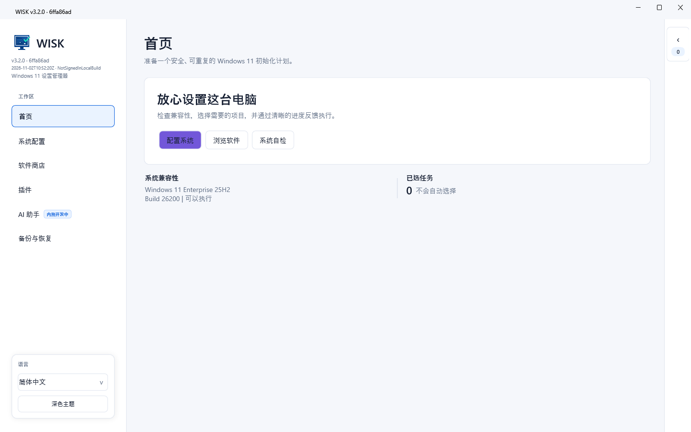
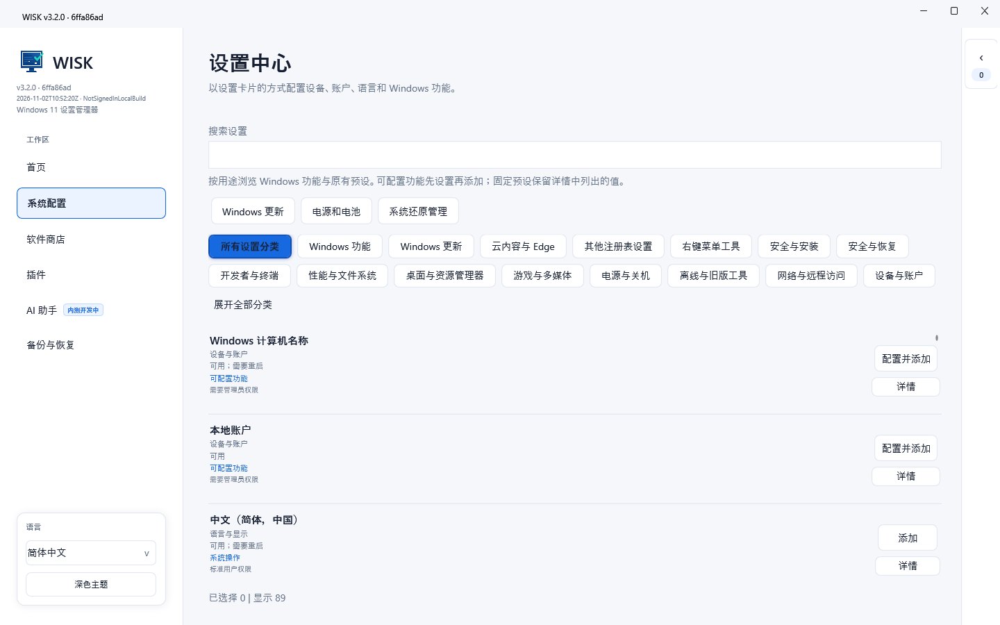
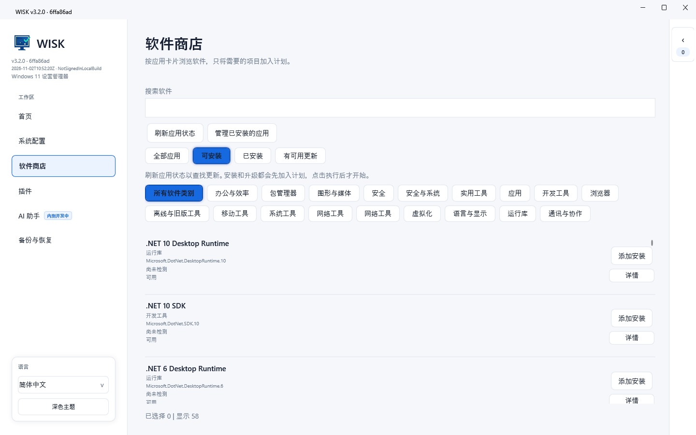
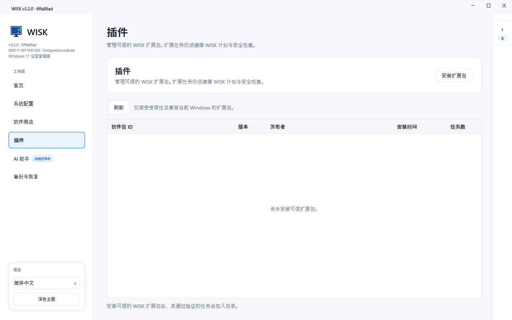
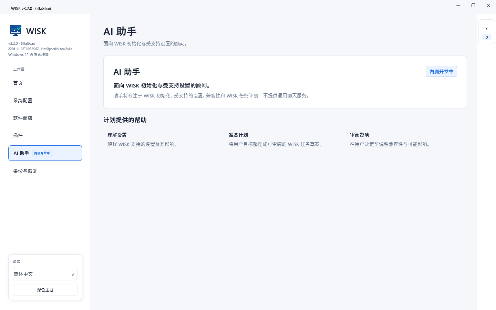

# WISK

[English](../README.md) | [简体中文](README.zh-CN.md) | [Русский](README.ru-RU.md)

[](https://github.com/MeowLove/WISK/actions/workflows/ci.yml)
[](../LICENSE)
[](https://github.com/MeowLove/WISK/releases)
[](https://github.com/MeowLove/WISK/stargazers)

WISK（Windows Init Setup Kit）是一个面向 Windows 11 的开源初始化与配置工作台。它把可审计的系统设置、注册表功能、软件任务、恢复证据和安全的 Check -> Apply -> Verify 执行模型放在同一条工作流中。

WISK 是 MeowLove Init Setup Kit 系列中的 Windows 项目，Linux 对应项目是 [LISK](https://github.com/MeowLove/LISK)。

## 关于 WISK

WISK 面向希望拥有可重复、可审查 Windows 配置流程的用户，而不是一组无法解释的一键优化开关。

- 版本源：[`VERSION`](../VERSION)
- 当前公开版本：[GitHub Releases](https://github.com/MeowLove/WISK/releases/latest)
- 项目发布页：[GitHub Releases](https://github.com/MeowLove/WISK/releases)
- 问题反馈：[GitHub Issues](https://github.com/MeowLove/WISK/issues/new?template=bug_report.md)
- 架构说明：[WISK 架构文档](WISK-3.0-Architecture.md)
- 测试指南：[Release 测试指南](Preview-Testing.md)

当前版本延续受控插件工作区和标记为“内测开发中”的 AI 助手占位页面。当前版本不调用云端 AI API、不运行本地 AI 模型，也不执行 AI 生成的操作。

## 截图

<!-- WISK_SCREENSHOT_1_START：主工作区与导航 -->

<!-- WISK_SCREENSHOT_1_END -->

<!-- WISK_SCREENSHOT_2_START：设置目录与分类筛选 -->

<!-- WISK_SCREENSHOT_2_END -->

<!-- WISK_SCREENSHOT_3_START：软件目录与筛选 -->

<!-- WISK_SCREENSHOT_3_END -->

<!-- WISK_SCREENSHOT_4_START：受控插件工作区 -->

<!-- WISK_SCREENSHOT_4_END -->

<!-- WISK_SCREENSHOT_5_START：AI 助手状态 -->

<!-- WISK_SCREENSHOT_5_END -->

## 功能概览

- 用公开、可检查的目录组织 Windows 初始化任务。
- 在应用系统、注册表或软件变更前生成可审查计划。
- 对支持的任务使用明确的 **Check -> Apply -> Verify** 边界。
- 保留任务关系、风险等级、计划哈希和执行证据。
- 在支持的注册表写入前保存原始值。
- 将“需要重启”的结果与之后的验证结果分开记录。
- 提供受控插件工作区，扩展不能绕过授权和审计记录。
- 在 WPF 应用和 CLI 之间复用同一套合同。

WISK 是管理工具，不是通用系统优化器、云端 AI 代理或无人值守脚本运行器。

## 使用场景

- 在修改前检查新的 Windows 11 安装。
- 准备可重复的工作站配置计划。
- 按用途组织软件、语言、隐私、桌面、资源管理器和电源任务。
- 在执行前查看依赖、冲突、权限和重启要求。
- 保留计划、执行和验证结果的审计记录。
- 导出恢复证据和诊断信息供人工检查。

## 运行要求

- Windows 11 x64
- 框架依赖构建需要 .NET 10 Windows Desktop Runtime
- 只有选中的任务需要时才要求管理员权限
- 本地开发需要 .NET SDK `10.0.401`

操作系统和运行时满足要求并不保证所有任务都可用。WISK 会在能够可靠判断时，在执行前报告任务可用性和兼容性证据。

## 快速开始

1. 下载当前公开版本，或在本地构建源码。
2. 启动程序并浏览任务目录。
3. 先配置参数，再把需要参数的任务加入计划。
4. 检查依赖、冲突、风险等级和所需权限。
5. 执行 **Check** 并查看计划结果。
6. 明确确认计划和授权后执行 **Apply**。
7. 执行后查看 **Verify** 结果；需要重启时先完成重启。

当前源码线不代表已经完成系统级验收。默认本地构建未签名，真实 UAC、注册表 Apply/Verify、软件安装、重启和 Authenticode 验证必须在隔离的 Windows 测试环境中进行。

## 典型工作流

### 准备工作站计划

1. 使用普通用户权限打开任务目录。
2. 配置需要参数的任务，检查依赖、冲突、风险和重启要求。
3. 执行 **Check**，在决定应用前查看不可变计划。

### 审查系统变更

1. 先选择一个范围明确的任务，不要直接执行大批量计划。
2. 确认任务可用性和授权要求。
3. 只在有测试恢复路径的一次性隔离 Windows 环境中执行 Apply。
4. 执行后查看 **Verify**，需要重启时在重启后再次验证。

### 准备问题反馈

1. 记录 WISK 版本、Windows 版本/内部版本号、运行时模式、任务 ID 和完整步骤。
2. 有诊断导出时先检查个人路径、设备名称和其他敏感内容。
3. 只向 GitHub Issue 附加已经脱敏的证据。

## 构建与测试

仓库使用 `global.json` 固定的 SDK，并将生成内容放在 `artifacts/` 下。

```powershell
.\Build-Wisk.ps1 -Target Build -Profile Development -RuntimeMode FrameworkDependent -Restore
.\Build-Wisk.ps1 -Target Test -Profile Test -RuntimeMode FrameworkDependent -Restore -Coverage
.\Build-Wisk.ps1 -Target Publish -Profile Release -RuntimeMode FrameworkDependent
.\Build-Wisk.ps1 -Target Publish -Profile Release -RuntimeMode SelfContained
node tools/validate-catalog.mjs
```

发布打包使用 `packaging/Publish-Release.ps1` 或 `packaging/Publish-Cli.ps1`。脚本生成 Windows x64 单文件包，并写入包含源码提交、文件哈希、构建时间和签名状态的清单。

## 架构与技术栈

- **WPF 应用**：首页、系统设置、软件、插件、AI 助手和备份与恢复工作区。
- **CLI**：复用同一套合同和执行边界，默认只读。
- **Contracts 与 Core**：负责任务描述、计划、模板、关系、校验和目录数据。
- **Execution**：负责 Check -> Apply -> Verify 状态、历史、诊断、取消和重启边界。
- **Windows 平台层**：将允许的任务 ID 映射到注册表、WinGet、Windows 能力和原生设置适配器。
- **PowerShell 桥接**：使用固定操作和分帧 JSON，不把用户输入拼接进脚本。

详见[架构文档](WISK-3.0-Architecture.md)。

## 排错与反馈

- 任务不可用时，先查看 Check 结果、运行要求、依赖和兼容性证据。
- 需要重启时，把 Apply 完成和重启后的 Verify 视为两个独立事实。
- Verify 无法可靠读取状态时，按人工复核处理，不要把它当成成功。
- 使用 [Release 测试指南](Preview-Testing.md) 查看包校验和隔离测试边界。
- 通过 [GitHub Issues](https://github.com/MeowLove/WISK/issues/new?template=bug_report.md) 提交可复现问题。

诊断导出只做尽力脱敏。分享前请检查截图、日志、本地路径、设备标识和软件清单。

## 安全边界

- 目录任务默认不选中。
- 提权和高风险任务需要明确授权。
- Check 阶段必须保持对系统变更只读。
- 支持的注册表写入前保存原始值。
- 真实 Apply/Verify 必须在隔离的 Windows 测试环境中验证。
- 没有经过测试的恢复路径时，不要在日常、工作或生产电脑上应用变更。

## 仓库结构

```text
src/                 WISK 应用层和共享合同
tests/               核心、执行、桥接、目录和 UI 合同测试
catalog/             公开软件/设置目录元数据
schema/              机器可读的目录和配置文件 Schema
packaging/           发布和 CLI 打包脚本
tools/               校验和冒烟测试工具
docs/                公开架构和开发文档
artifacts/           被忽略的构建、测试和发布输出
```

## 参与贡献

请阅读 [`CONTRIBUTING.md`](../CONTRIBUTING.md)、[`AGENTS.md`](../AGENTS.md) 和[文档索引](README.md)。不要提交本地需求、凭据、用户数据、签名密钥或生成的构建输出。

## 许可证

请参阅 [LICENSE](../LICENSE)。
